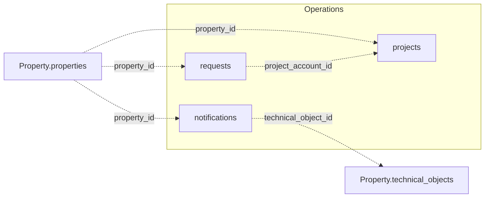

The three tables below join to the Property domain; `requests` also links to `projects`. See the
[Data Model Overview](/v1/data-model/overview) for the complete cross-domain diagram.

## notifications

`GET /v1/operations/notifications` — maintenance reports and damage notifications.

<ResponseField name="property_id" type="string" required>
  Unique property identifier.
</ResponseField>

<ResponseField name="report_id" type="integer" required>
  Unique identifier for the notification.
</ResponseField>

<ResponseField name="technical_object_id" type="integer">
  Technical object the report concerns.
</ResponseField>

<ResponseField name="reporter_key" type="integer">
  Key for whoever filed the report: property, unit and reporter number combined into one
  number, separators dropped. Not a person ID — it doesn't join to `Stakeholder.tenants.person_id`.
</ResponseField>

<ResponseField name="cost_center" type="object">
  Cost centre the report is booked against, as a structured object — same shape as
  `projects.cost_center`.
  <Expandable title="properties">
    <ResponseField name="code" type="string">
      Cost-centre code.
    </ResponseField>
    <ResponseField name="label" type="string">
      Cost-centre name.
    </ResponseField>
  </Expandable>
</ResponseField>

<ResponseField name="to_do_period" type="object">
  Deadline window for resolving the report.
  <Expandable title="properties">
    <ResponseField name="start" type="date">
      Start of the window.
    </ResponseField>
    <ResponseField name="end" type="date">
      Deadline for resolution.
    </ResponseField>
  </Expandable>
</ResponseField>

<ResponseField name="report_name" type="string">
  Subject / title of the report.
</ResponseField>

<ResponseField name="report_type" type="string">
  Type of report.
</ResponseField>

<ResponseField name="reporter_type" type="string">
  Who filed the report: tenant, creditor, owner, user, or partner.
</ResponseField>

<ResponseField name="report_number" type="string">
  Report number.
</ResponseField>

<ResponseField name="user_creation" type="string">
  User who created the report.
</ResponseField>

<ResponseField name="report_date" type="date">
  Date the report was filed.
</ResponseField>

<ResponseField name="responsible_team" type="string">
  Team responsible for handling the report.
</ResponseField>

<ResponseField name="responsible_user" type="string">
  Individual responsible for handling the report.
</ResponseField>

<ResponseField name="priority_text" type="string">
  Priority level.
</ResponseField>

<ResponseField name="status" type="string">
  Current status of the report.
</ResponseField>

<ResponseField name="status_date" type="date">
  Date of the last status change.
</ResponseField>

<ResponseField name="duration_days" type="integer">
  Number of days the report has been in process.
</ResponseField>

<ResponseField name="is_insurance_case" type="boolean">
  Whether this report is an insurance claim.
</ResponseField>

<ResponseField name="comment" type="string">
  Free-text comment.
</ResponseField>

## projects

`GET /v1/operations/projects` — capital projects and larger maintenance initiatives, one row
per project.

<Note>
  The table returns every project of the property management, whatever its status — also
  projects that are only planned, applied for, already settled, or carried out by the
  owner. Filter on `status` if you only need some of them. Fields that pointed to a single
  offer, order or notification (`offer_id`, `creditor_id`, `report_id` and their numbers)
  are no longer part of `projects`: a project can have many of each. Use
  `project_account_id` to find the requests of a project.
</Note>

<ResponseField name="property_id" type="string" required>
  Unique property identifier.
</ResponseField>

<ResponseField name="project_id" type="integer" required>
  Unique identifier for the project. Not the same value as `project_number` below.
</ResponseField>

<ResponseField name="project_account_id" type="integer">
  Project account the project is booked on. `requests.project_account_id` points here —
  use it to find the requests belonging to a project.
</ResponseField>

<ResponseField name="hierarchy" type="string[]">
  Where the project sits in the accounting chart of accounts, as an ordered list from
  coarse to fine (e.g. `["1000/10/20/01", "1000/10/20/01.1", "1000/10/20/01.1.5"]`).
  Segments are separated by `/` at the higher levels and `.` for finer subdivisions — not
  a purely dot-separated numeric form. Empty, deeper levels are omitted.
</ResponseField>

<ResponseField name="cost_center" type="object">
  Cost centre the project is booked against, as a structured object.
  <Expandable title="properties">
    <ResponseField name="code" type="string">
      Cost-centre code.
    </ResponseField>
    <ResponseField name="label" type="string">
      Cost-centre name.
    </ResponseField>
  </Expandable>
</ResponseField>

<ResponseField name="project_period" type="object">
  Planned duration of the project.
  <Expandable title="properties">
    <ResponseField name="start" type="date">
      Project start date.
    </ResponseField>
    <ResponseField name="end" type="date">
      Project end date.
    </ResponseField>
  </Expandable>
</ResponseField>

<ResponseField name="budget_period" type="object">
  Period the project's budget covers.
  <Expandable title="properties">
    <ResponseField name="start" type="date">
      Start of the budget period.
    </ResponseField>
    <ResponseField name="end" type="date">
      End of the budget period.
    </ResponseField>
  </Expandable>
</ResponseField>

<ResponseField name="account_name" type="string">
  Name of the project account.
</ResponseField>

<ResponseField name="ledger_account" type="string">
  Comma-separated list of general ledger account numbers for the project — usually
  several, not a single value.
</ResponseField>

<ResponseField name="ledger_account_number" type="string">
  Despite the name, not a ledger-account identifier — the same value as `cost_center.code`
  under a different field name (both derive from the same source column). Use
  `ledger_account` for the actual general ledger account number(s).
</ResponseField>

<ResponseField name="project_type" type="string">
  Project type.
</ResponseField>

<ResponseField name="status" type="string">
  Current project status, as a text label defined by the property manager (for example
  `in Planung`, `genehmigt`, `abgerechnet`). Labels differ between customers.
</ResponseField>

<ResponseField name="comments" type="object[]">
  Comments and notes, as a list of objects. Combines what were four separate fields —
  `comment` (a status comment) and `comment_1`/`comment_2`/`comment_3` (notes) — into one
  array; empty entries are omitted. Each entry keeps its origin via `type`.
  <Expandable title="properties">
    <ResponseField name="type" type="string">
      Where the entry came from: `status`, `hint_1`, `hint_2`, or `hint_3`.
    </ResponseField>
    <ResponseField name="text" type="string">
      The comment or note text.
    </ResponseField>
  </Expandable>
</ResponseField>

<ResponseField name="percentage_completed" type="number">
  Completion percentage.
</ResponseField>

<ResponseField name="project_budget" type="number">
  Total budgeted amount for the project.
</ResponseField>

<ResponseField name="funding_limit_obligo" type="number">
  Committed-but-not-yet-invoiced budget limit.
</ResponseField>

<ResponseField name="actual_value" type="number">
  Actual, booked value to date.
</ResponseField>

<ResponseField name="entered_value" type="number">
  Recorded value.
</ResponseField>

<ResponseField name="activated_value" type="number">
  Capitalised value.
</ResponseField>

<ResponseField name="modernized_value" type="number">
  Modernisation value.
</ResponseField>

<ResponseField name="maintenance_value" type="number">
  Maintenance value.
</ResponseField>

<ResponseField name="is_project_management" type="string">
  Project management classification flag (`"0"`/`"1"`).
</ResponseField>

<ResponseField name="project_lead_budget" type="number">
  Budget allocated to the project lead.
</ResponseField>

<ResponseField name="overhead_charge_mode" type="integer">
  Overhead-charge calculation mode.
</ResponseField>

<ResponseField name="overhead_charge_percent" type="number">
  Overhead charge, as a percentage.
</ResponseField>

<ResponseField name="overhead_charge_value" type="number">
  Overhead charge amount.
</ResponseField>

<ResponseField name="industry_name" type="string">
  Trade / industry the project belongs to.
</ResponseField>

<ResponseField name="responsible_team" type="string">
  Team responsible for the project.
</ResponseField>

<ResponseField name="responsible_user" type="string">
  Individual responsible for the project.
</ResponseField>

<ResponseField name="budget_text" type="string">
  Budget description.
</ResponseField>

<ResponseField name="budget_comment" type="string">
  Comment on the budget.
</ResponseField>

<ResponseField name="dms_link" type="string">
  Link to the linked document in the DMS.
</ResponseField>

<ResponseField name="project_number" type="string">
  Business/display project number. Not the same identifier as `project_id` above.
</ResponseField>

## requests

`GET /v1/operations/requests` — requests for quotation from the maintenance process, one row
per request, also when no offer has come in yet.

<ResponseField name="property_id" type="string" required>
  Unique property identifier.
</ResponseField>

<ResponseField name="request_id" type="integer" required>
  Unique identifier for the request. Not the same value as `request_number` below.
</ResponseField>

<ResponseField name="project_account_id" type="integer">
  Project account the request belongs to, if any. Joins to `projects.project_account_id`.
  Empty for requests outside a project; a few values have no matching project.
</ResponseField>

<ResponseField name="cost_center" type="object">
  Cost centre the request is booked against, same shape as `projects.cost_center`.
  <Expandable title="properties">
    <ResponseField name="code" type="string">
      Cost-centre code.
    </ResponseField>
    <ResponseField name="label" type="string">
      Cost-centre name.
    </ResponseField>
  </Expandable>
</ResponseField>

<ResponseField name="floor_area_id" type="string">
  Unit the request concerns, if it concerns a single unit.
</ResponseField>

<ResponseField name="request_period" type="object">
  Period the requested work covers.
  <Expandable title="properties">
    <ResponseField name="start" type="date">
      Start date.
    </ResponseField>
    <ResponseField name="end" type="date">
      End date.
    </ResponseField>
  </Expandable>
</ResponseField>

<ResponseField name="request_name" type="string">
  Subject / title of the request.
</ResponseField>

<ResponseField name="request_type" type="string">
  Type of request.
</ResponseField>

<ResponseField name="status_text" type="string">
  Current status of the request.
</ResponseField>

<ResponseField name="priority_text" type="string">
  Priority level.
</ResponseField>

<ResponseField name="request_number" type="string">
  Business/display request number. Not the same identifier as `request_id` above.
</ResponseField>
