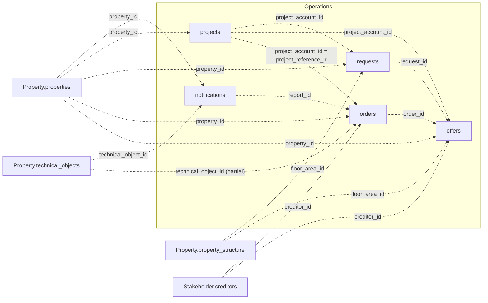

The five tables below join to the Property domain and to each other as shown in the diagram. See the
[Data Model Overview](/v1/data-model/overview) for the complete cross-domain diagram.

## notifications

`GET /v1/operations/notifications` — maintenance reports and damage notifications.

<ResponseField name="property_id" type="string" required>
  Unique property identifier.
</ResponseField>

<ResponseField name="report_id" type="integer" required>
  Unique identifier for the notification.
</ResponseField>

<ResponseField name="technical_object_id" type="integer">
  Technical object the report concerns. Joins to `Property.technical_objects.technical_object_id`,
  but not every value has a matching technical object.
</ResponseField>

<ResponseField name="reporter_key" type="integer">
  Key for whoever filed the report: property, unit and reporter number combined into one
  number, separators dropped. Not a person ID — it doesn't join to `Stakeholder.tenants.person_id`.
</ResponseField>

<ResponseField name="cost_center" type="object">
  Cost centre the report is booked against, as a structured object — same shape as
  `projects.cost_center`.
  <Expandable title="properties">
    <ResponseField name="code" type="string">
      Cost-centre code.
    </ResponseField>
    <ResponseField name="label" type="string">
      Cost-centre name.
    </ResponseField>
  </Expandable>
</ResponseField>

<ResponseField name="to_do_period" type="object">
  Deadline window for resolving the report.
  <Expandable title="properties">
    <ResponseField name="start" type="date">
      Start of the window.
    </ResponseField>
    <ResponseField name="end" type="date">
      Deadline for resolution.
    </ResponseField>
  </Expandable>
</ResponseField>

<ResponseField name="report_name" type="string">
  Subject / title of the report.
</ResponseField>

<ResponseField name="report_type" type="string">
  Type of report.
</ResponseField>

<ResponseField name="reporter_type" type="string">
  Who filed the report: tenant, creditor, owner, user, or partner.
</ResponseField>

<ResponseField name="reporter_person" type="string">
  Requires the [`personal` grant](/v1/authentication#personal-data-grants).
  Who filed the report, as free text — usually a reference number and a name, for example
  `1111+200011 | Name`.
</ResponseField>

<ResponseField name="report_number" type="string">
  Report number.
</ResponseField>

<ResponseField name="user_creation" type="string">
  Requires the [`personal` grant](/v1/authentication#personal-data-grants).
  User who created the report.
</ResponseField>

<ResponseField name="report_date" type="date">
  Date the report was filed.
</ResponseField>

<ResponseField name="responsible_team" type="string">
  Team responsible for handling the report, as a numeric team ID (for example `1`). No team
  name is available, unlike `projects.responsible_team`.
</ResponseField>

<ResponseField name="responsible_user" type="string">
  Requires the [`personal` grant](/v1/authentication#personal-data-grants).
  Individual responsible for handling the report.
</ResponseField>

<ResponseField name="priority_text" type="string">
  Despite the name, not a priority: the label comes from the same list as `status` (for
  example `Neu`, `In Bearbeitung`, `Erledigt`). Empty for some customers.
</ResponseField>

<ResponseField name="status" type="string">
  Current status of the report.
</ResponseField>

<ResponseField name="status_date" type="date">
  Date of the last status change.
</ResponseField>

<ResponseField name="duration_days" type="integer">
  Number of days the report has been in process.
</ResponseField>

<ResponseField name="is_insurance_case" type="boolean">
  Whether this report is an insurance claim.
</ResponseField>

<ResponseField name="comment" type="string">
  Requires the [`personal` grant](/v1/authentication#personal-data-grants).
  Free-text comment.
</ResponseField>

## offers

`GET /v1/operations/offers` — offers that contractors submitted in response to a request for
quotation, one row per offer. A request can have several offers; requests without any offer
are only in `requests`.

<ResponseField name="property_id" type="string" required>
  Unique property identifier.
</ResponseField>

<ResponseField name="offer_id" type="integer" required>
  Unique identifier for the offer. Not the same value as `offer_nr` below.
</ResponseField>

<ResponseField name="cost_center_id" type="string">
  Cost centre of the request: property number plus unit, floor or building (for example
  `1106/10023`), or just the property number.
</ResponseField>

<ResponseField name="floor_area_id" type="integer">
  Unit the request concerns, if it concerns a single unit. Joins to
  `Property.property_structure.floor_area_id`.
</ResponseField>

<ResponseField name="request_id" type="integer" required>
  Request for quotation the offer answers. Joins to `requests.request_id`.
</ResponseField>

<ResponseField name="contract_id" type="integer">
  Contract reference recorded on the offer. Not a join key: it doesn't match
  `Contracts.service_contracts.contract_id`.
</ResponseField>

<ResponseField name="order_id" type="integer">
  Order placed on the basis of this offer, if any. Joins to `orders.order_id`.
</ResponseField>

<ResponseField name="project_account_id" type="integer">
  Project account the request belongs to, if any. Joins to `projects.project_account_id`;
  a few values have no matching project.
</ResponseField>

<ResponseField name="creditor_id" type="string">
  Contractor that submitted the offer. Joins to `Stakeholder.creditors.creditor_id`.
</ResponseField>

<ResponseField name="offer_period" type="object">
  Validity period of the request, taken from the request (same as `requests.request_period`).
  Not the period the work is carried out in — for that see `orders.runtime_period`.
  <Expandable title="properties">
    <ResponseField name="start" type="date">
      Start date.
    </ResponseField>
    <ResponseField name="end" type="date">
      End date.
    </ResponseField>
  </Expandable>
</ResponseField>

<ResponseField name="cost_center_id_name" type="string">
  `cost_center_id` and cost-centre name as one display string. For display, not for joining.
</ResponseField>

<ResponseField name="request_nr" type="string">
  Display number of the request, same as `requests.request_number`.
</ResponseField>

<ResponseField name="offer_nr" type="string">
  Offer number as recorded in the ERP, if any. Not the same identifier as `offer_id`.
</ResponseField>

<ResponseField name="offer_name" type="string">
  Subject of the request the offer answers.
</ResponseField>

<ResponseField name="offer_type" type="string">
  Type of request, for example `Anfrage Instandhaltung`.
</ResponseField>

<ResponseField name="offer_value" type="number">
  Offered price. `0` when no price was recorded.
</ResponseField>

<ResponseField name="status_text" type="string">
  Status of the request as a numeric status code from the ERP, for example `21` or `23`.
  No plain-text label is available. Same value as `requests.status_text`.
</ResponseField>

<ResponseField name="priority_text" type="string">
  Priority of the request as number and label, for example `3 | Mittel`.
</ResponseField>

<ResponseField name="comment" type="string">
  Requires the [`personal` grant](/v1/authentication#personal-data-grants).
  Free-text remark on the offer.
</ResponseField>

<ResponseField name="offer_accepted" type="boolean">
  Whether the offer was accepted. `null` when not set.
</ResponseField>

<ResponseField name="order_accepted_offer" type="boolean">
  Whether the offer is marked as the award recommendation. Despite the name, this is not
  a confirmation that an order was placed; use `order_id` for that. `null` when not set.
</ResponseField>

## orders

`GET /v1/operations/orders` — maintenance and repair orders placed with contractors, one row per
order.

<Note>
  All position-level fields (`position_amount`, `position_description`, `quantity`, `unit`,
  `price`, `vat_rate_position`, `position_*_amount`, `position_obligo_net`, `invoice_status`)
  come from the order's **first position only**. For orders with several positions, use the
  order-level fields (`total_amount`, `order_*_amount`, `order_obligo_net`) for totals.
</Note>

<ResponseField name="order_id" type="integer" required>
  Unique identifier for the order. Not the same value as `order_number` below.
</ResponseField>

<ResponseField name="person_id" type="string">
  Composite key of property, unit and person number with separators dropped. It identifies
  the occupant of the unit the order concerns, but it doesn't join to
  `Stakeholder.tenants.person_id`.
</ResponseField>

<ResponseField name="property_id" type="string" required>
  Unique property identifier. Joins to `Property.properties.property_id`.
</ResponseField>

<ResponseField name="offer_reference_id" type="integer">
  Offer number the order refers to, as a number. Not a join key: it doesn't match
  `offers.offer_id`.
</ResponseField>

<ResponseField name="project_reference_id" type="integer">
  Project account the order is booked to, if any. Joins to `projects.project_account_id`, not
  to `projects.project_id`.
</ResponseField>

<ResponseField name="cost_center_id" type="string">
  Cost centre the order is booked against: property number plus unit, floor or building
  (for example `1101/20022`), or just the property number.
</ResponseField>

<ResponseField name="technical_object_id" type="integer">
  Technical object the order concerns. Joins to `Property.technical_objects.technical_object_id`,
  but not every value has a matching technical object.
</ResponseField>

<ResponseField name="report_id" type="integer">
  Notification the order was created from, if any. Joins to `notifications.report_id`.
</ResponseField>

<ResponseField name="creditor_id" type="string">
  Contractor the order was placed with. Joins to `Stakeholder.creditors.creditor_id`.
</ResponseField>

<ResponseField name="total_amount" type="object">
  Ordered value of the order from its priced positions. `0` when the order was placed without
  prices; actual costs then only show in `order_recorded_amount`, `order_booked_amount` and
  `order_paid_amount`.
  <Expandable title="properties">
    <ResponseField name="net" type="number">
      Net amount.
    </ResponseField>
    <ResponseField name="gross" type="number">
      Gross amount including VAT.
    </ResponseField>
  </Expandable>
</ResponseField>

<ResponseField name="position_amount" type="object">
  Ordered value of the first position. `0` when the position has no price.
  <Expandable title="properties">
    <ResponseField name="net" type="number">
      Net amount.
    </ResponseField>
    <ResponseField name="gross" type="number">
      Gross amount including VAT.
    </ResponseField>
  </Expandable>
</ResponseField>

<ResponseField name="ledger_account" type="object">
  Ledger account the order costs are booked to.
  <Expandable title="properties">
    <ResponseField name="code" type="string">
      Accounting entity and account number, joined by `+` (for example `1101+641005`).
    </ResponseField>
    <ResponseField name="label" type="string">
      Account name, e.g. "Laufende Reparaturen Wohnung".
    </ResponseField>
  </Expandable>
</ResponseField>

<ResponseField name="runtime_period" type="object">
  Period in which the work is to be carried out.
  <Expandable title="properties">
    <ResponseField name="start" type="date">
      Start date.
    </ResponseField>
    <ResponseField name="end" type="date">
      End date.
    </ResponseField>
  </Expandable>
</ResponseField>

<ResponseField name="order_number" type="string">
  Business/display order number, e.g. `2018/00001`. Not the same identifier as `order_id`.
</ResponseField>

<ResponseField name="order_name" type="string">
  Subject / title of the order.
</ResponseField>

<ResponseField name="offer_number" type="string">
  Offer number as entered on the order, if the order is based on an offer.
</ResponseField>

<ResponseField name="order_type" type="string">
  Type of order, e.g. "Laufende Instandhaltung".
</ResponseField>

<ResponseField name="object_description" type="string">
  Requires the [`personal` grant](/v1/authentication#personal-data-grants).
  Description of the property the order belongs to.
</ResponseField>

<ResponseField name="creditor_name" type="string">
  Requires the [`personal` grant](/v1/authentication#personal-data-grants).
  Name of the contractor.
</ResponseField>

<ResponseField name="project_nr" type="string">
  Project account the order is booked to, as accounting entity and account number joined by
  `+`. Empty for orders outside a project.
</ResponseField>

<ResponseField name="cost_center_id_name" type="string">
  `cost_center_id` and the cost-centre name as one display string. For display only, not for
  joining.
</ResponseField>

<ResponseField name="vat_code" type="integer">
  VAT code of the first position.
</ResponseField>

<ResponseField name="vat_rate" type="number">
  VAT rate in percent that applied to `vat_code` on the order's reference date.
</ResponseField>

<ResponseField name="vat_code_type" type="string">
  Two-letter type of the VAT code from the ERP, e.g. `VN`.
</ResponseField>

<ResponseField name="position_description" type="string">
  Requires the [`personal` grant](/v1/authentication#personal-data-grants).
  Free-text description of the first position.
</ResponseField>

<ResponseField name="order_recorder_name" type="string">
  Requires the [`personal` grant](/v1/authentication#personal-data-grants).
  Not populated; always an empty string.
</ResponseField>

<ResponseField name="order_recorder_mail" type="string">
  Requires the [`personal` grant](/v1/authentication#personal-data-grants).
  Not populated; always an empty string.
</ResponseField>

<ResponseField name="order_processor_name" type="string">
  Requires the [`personal` grant](/v1/authentication#personal-data-grants).
  Not populated; always an empty string.
</ResponseField>

<ResponseField name="order_processor_mail" type="string">
  Requires the [`personal` grant](/v1/authentication#personal-data-grants).
  Not populated; always an empty string.
</ResponseField>

<ResponseField name="order_responsible_name" type="string">
  Requires the [`personal` grant](/v1/authentication#personal-data-grants).
  Not populated; always an empty string.
</ResponseField>

<ResponseField name="order_responsible_mail" type="string">
  Requires the [`personal` grant](/v1/authentication#personal-data-grants).
  Not populated; always an empty string.
</ResponseField>

<ResponseField name="report_number" type="string">
  Display number of the notification in `report_id`.
</ResponseField>

<ResponseField name="to_number" type="string">
  Display number of the technical object in `technical_object_id`.
</ResponseField>

<ResponseField name="to_number_internal" type="string">
  Internal number of the technical object.
</ResponseField>

<ResponseField name="to_description" type="string">
  Name of the technical object.
</ResponseField>

<ResponseField name="note1" type="string">
  Requires the [`personal` grant](/v1/authentication#personal-data-grants).
  Free-text note on the order.
</ResponseField>

<ResponseField name="damage_date" type="date">
  Date the damage occurred, for repair orders.
</ResponseField>

<ResponseField name="handyman_portal_transfer" type="boolean">
  Whether orders of this type are passed on to the contractor portal.
</ResponseField>

<ResponseField name="status_type_description" type="string">
  Processing status: `Neu`, `In Genehmigung`, `Genehmigt`, `In Bearbeitung`, `Erledigt` or
  `Storniert`.
</ResponseField>

<ResponseField name="priority_description" type="string">
  Priority level.
</ResponseField>

<ResponseField name="reporter_type_description" type="string">
  Who reported the issue: `Personen` (a person such as a tenant), `Kreditor` (a contractor) or
  `Benutzer` (a user of the management system).
</ResponseField>

<ResponseField name="reporter_info" type="string">
  Requires the [`personal` grant](/v1/authentication#personal-data-grants).
  Free-text information about the reporter, often name and phone number.
</ResponseField>

<ResponseField name="reporter_person_full_name" type="string">
  Requires the [`personal` grant](/v1/authentication#personal-data-grants).
  Full name of the reporter if the reporter is a known person, otherwise the same text as
  `reporter_info`.
</ResponseField>

<ResponseField name="quantity" type="number">
  Quantity of the first position.
</ResponseField>

<ResponseField name="unit" type="number">
  Unit field of the first position, delivered as a number.
</ResponseField>

<ResponseField name="price" type="number">
  Unit price of the first position.
</ResponseField>

<ResponseField name="vat_rate_position" type="number">
  VAT rate in percent as entered on the first position.
</ResponseField>

<ResponseField name="invoice_status" type="string">
  Payment progress of the first position, derived from its amounts: `Bezahlt` (paid in full),
  `Gebucht` (booked), `Erfasst` (invoice recorded), `Obligo` (committed) or `Offen` (open).
</ResponseField>

<ResponseField name="position_obligo_net" type="number">
  Committed net amount (obligo) of the first position.
</ResponseField>

<ResponseField name="position_recorded_amount" type="number">
  Invoiced amount recorded for the first position.
</ResponseField>

<ResponseField name="position_booked_amount" type="number">
  Amount booked for the first position.
</ResponseField>

<ResponseField name="position_paid_amount" type="number">
  Amount paid for the first position.
</ResponseField>

<ResponseField name="order_obligo_net" type="number">
  Committed net amount (obligo) of the whole order.
</ResponseField>

<ResponseField name="order_recorded_amount" type="number">
  Invoiced amount recorded for the whole order.
</ResponseField>

<ResponseField name="order_booked_amount" type="number">
  Amount booked for the whole order.
</ResponseField>

<ResponseField name="order_paid_amount" type="number">
  Amount paid for the whole order.
</ResponseField>

<ResponseField name="dms_link" type="string">
  Link to the documents in the customer's document management system. Without a connected DMS
  the field holds a placeholder text instead of a URL; check for a URL before rendering a link.
</ResponseField>

## projects

`GET /v1/operations/projects` — capital projects and larger maintenance initiatives, one row
per project.

<Note>
  The table returns every project of the property management, whatever its status — also
  projects that are only planned, applied for, already settled, or carried out by the
  owner. Filter on `status` if you only need some of them. Fields that pointed to a single
  offer, order or notification (`offer_id`, `creditor_id`, `report_id` and their numbers)
  are no longer part of `projects`: a project can have many of each. Use
  `project_account_id` to find the requests, offers and orders of a project.
</Note>

<ResponseField name="property_id" type="string" required>
  Unique property identifier.
</ResponseField>

<ResponseField name="project_id" type="integer" required>
  Unique identifier for the project. Not the same value as `project_number` below.
</ResponseField>

<ResponseField name="project_account_id" type="integer">
  Project account the project is booked on. `requests.project_account_id`,
  `offers.project_account_id` and `orders.project_reference_id` point here — use it to find
  the requests, offers and orders belonging to a project.
</ResponseField>

<ResponseField name="hierarchy" type="string[]">
  Where the project sits in the accounting chart of accounts, as an ordered list from
  coarse to fine (e.g. `["1000/10/20/01", "1000/10/20/01.1", "1000/10/20/01.1.5"]`).
  Segments are separated by `/` at the higher levels and `.` for finer subdivisions — not
  a purely dot-separated numeric form. Empty, deeper levels are omitted.
</ResponseField>

<ResponseField name="cost_center" type="object">
  Cost centre the project is booked against, as a structured object.
  <Expandable title="properties">
    <ResponseField name="code" type="string">
      Cost-centre code.
    </ResponseField>
    <ResponseField name="label" type="string">
      Cost-centre name.
    </ResponseField>
  </Expandable>
</ResponseField>

<ResponseField name="project_period" type="object">
  Planned duration of the project.
  <Expandable title="properties">
    <ResponseField name="start" type="date">
      Project start date.
    </ResponseField>
    <ResponseField name="end" type="date">
      Project end date.
    </ResponseField>
  </Expandable>
</ResponseField>

<ResponseField name="budget_period" type="object">
  Period the project's budget covers.
  <Expandable title="properties">
    <ResponseField name="start" type="date">
      Start of the budget period.
    </ResponseField>
    <ResponseField name="end" type="date">
      End of the budget period.
    </ResponseField>
  </Expandable>
</ResponseField>

<ResponseField name="account_name" type="string">
  Name of the project account.
</ResponseField>

<ResponseField name="ledger_account" type="string">
  Comma-separated list of general ledger account numbers for the project — usually
  several, not a single value.
</ResponseField>

<ResponseField name="ledger_account_number" type="string">
  Despite the name, not a ledger-account identifier — the same value as `cost_center.code`
  under a different field name (both derive from the same source column). Use
  `ledger_account` for the actual general ledger account number(s).
</ResponseField>

<ResponseField name="project_type" type="string">
  Project type.
</ResponseField>

<ResponseField name="status" type="string">
  Current project status, as a text label defined by the property manager (for example
  `beantragt`, `in Planung`, `genehmigt`). Labels differ between customers.
</ResponseField>

<ResponseField name="comments" type="object[]">
  Requires the [`personal` grant](/v1/authentication#personal-data-grants).
  Comments and notes, as a list of objects. Combines what were four separate fields —
  `comment` (a status comment) and `comment_1`/`comment_2`/`comment_3` (notes) — into one
  array. Entries without text are included with an empty `text`. Each entry keeps its origin
  via `type`.
  <Expandable title="properties">
    <ResponseField name="type" type="string">
      Where the entry came from: `status`, `hint_1`, `hint_2`, or `hint_3`.
    </ResponseField>
    <ResponseField name="text" type="string">
      The comment or note text.
    </ResponseField>
  </Expandable>
</ResponseField>

<ResponseField name="percentage_completed" type="number">
  Completion percentage.
</ResponseField>

<ResponseField name="project_budget" type="number">
  Total budgeted amount for the project.
</ResponseField>

<ResponseField name="funding_limit_obligo" type="number">
  Committed-but-not-yet-invoiced budget limit.
</ResponseField>

<ResponseField name="actual_value" type="number">
  Actual, booked value to date.
</ResponseField>

<ResponseField name="entered_value" type="number">
  Recorded value.
</ResponseField>

<ResponseField name="activated_value" type="number">
  Capitalised value.
</ResponseField>

<ResponseField name="modernized_value" type="number">
  Modernisation value.
</ResponseField>

<ResponseField name="maintenance_value" type="number">
  Maintenance value.
</ResponseField>

<ResponseField name="is_project_management" type="string">
  Project management classification flag (`"0"`/`"1"`).
</ResponseField>

<ResponseField name="project_lead_budget" type="number">
  Budget allocated to the project lead.
</ResponseField>

<ResponseField name="overhead_charge_mode" type="integer">
  Overhead-charge calculation mode.
</ResponseField>

<ResponseField name="overhead_charge_percent" type="number">
  Overhead charge, as a percentage.
</ResponseField>

<ResponseField name="overhead_charge_value" type="number">
  Overhead charge amount.
</ResponseField>

<ResponseField name="industry_name" type="string">
  Trade / industry the project belongs to.
</ResponseField>

<ResponseField name="responsible_team" type="string">
  Team responsible for the project.
</ResponseField>

<ResponseField name="responsible_user" type="string">
  Requires the [`personal` grant](/v1/authentication#personal-data-grants).
  Individual responsible for the project.
</ResponseField>

<ResponseField name="budget_text" type="string">
  Budget description.
</ResponseField>

<ResponseField name="budget_comment" type="string">
  Requires the [`personal` grant](/v1/authentication#personal-data-grants).
  Comment on the budget.
</ResponseField>

<ResponseField name="dms_link" type="string">
  Link to the documents in the customer's document management system. Without a connected DMS
  the field holds a placeholder text instead of a URL; check for a URL before rendering a link.
</ResponseField>

<ResponseField name="project_number" type="string">
  Business/display project number. Not the same identifier as `project_id` above.
</ResponseField>

## requests

`GET /v1/operations/requests` — requests for quotation from the maintenance process, one row
per request, also when no offer has come in yet.

<ResponseField name="property_id" type="string" required>
  Unique property identifier.
</ResponseField>

<ResponseField name="request_id" type="integer" required>
  Unique identifier for the request. Not the same value as `request_number` below.
</ResponseField>

<ResponseField name="project_account_id" type="integer">
  Project account the request belongs to, if any. Joins to `projects.project_account_id`.
  Empty for requests outside a project; a few values have no matching project.
</ResponseField>

<ResponseField name="cost_center" type="object">
  Cost centre the request is booked against, same shape as `projects.cost_center`.
  <Expandable title="properties">
    <ResponseField name="code" type="string">
      Cost-centre code.
    </ResponseField>
    <ResponseField name="label" type="string">
      Cost-centre name.
    </ResponseField>
  </Expandable>
</ResponseField>

<ResponseField name="floor_area_id" type="integer">
  Unit the request concerns, if it concerns a single unit. Joins to
  `Property.property_structure.floor_area_id`.
</ResponseField>

<ResponseField name="request_period" type="object">
  Validity period of the request. Not the period the work is carried out in — for that see
  `orders.runtime_period`.
  <Expandable title="properties">
    <ResponseField name="start" type="date">
      Start date.
    </ResponseField>
    <ResponseField name="end" type="date">
      End date.
    </ResponseField>
  </Expandable>
</ResponseField>

<ResponseField name="request_name" type="string">
  Subject / title of the request.
</ResponseField>

<ResponseField name="request_type" type="string">
  Type of request.
</ResponseField>

<ResponseField name="status_text" type="string">
  Status of the request as a numeric status code from the ERP, for example `21` or `23`.
  No plain-text label is available.
</ResponseField>

<ResponseField name="priority_text" type="string">
  Priority of the request as number and label, for example `3 | Mittel`.
</ResponseField>

<ResponseField name="request_number" type="string">
  Business/display request number. Not the same identifier as `request_id` above.
</ResponseField>
